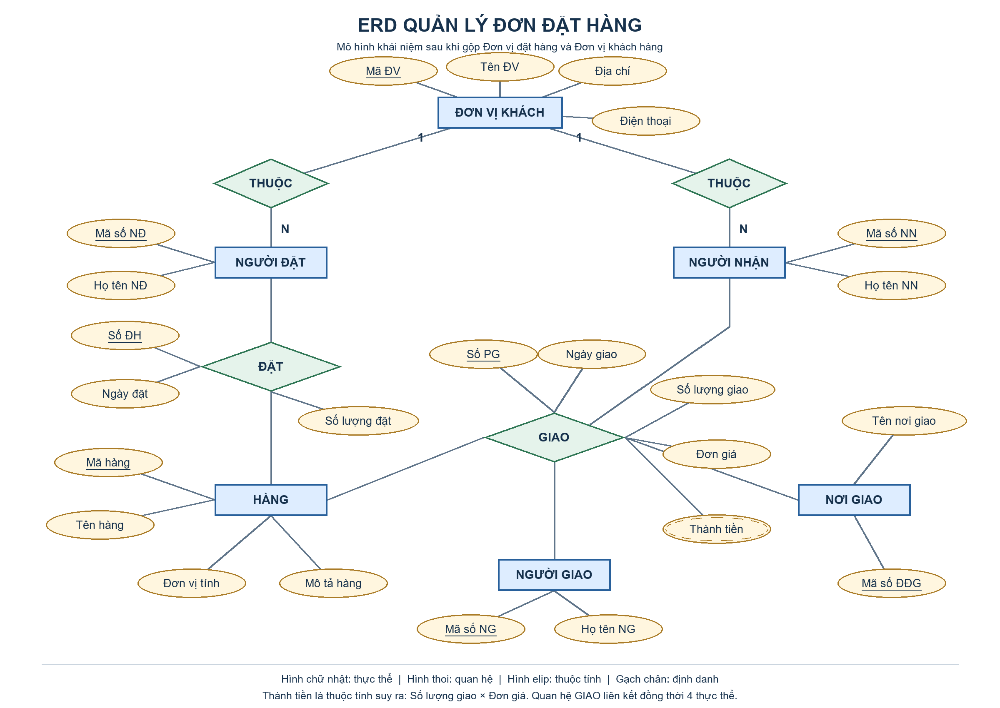

# ERD quản lý đơn đặt hàng

Bài thực hành xây dựng mô hình thực thể – liên kết (ERD) cho cơ sở dữ liệu quản lý đơn đặt hàng tại CodeGym.

## Sơ đồ ERD

## 1. Thực thể và thuộc tính

| Thực thể | Định danh | Thuộc tính còn lại |
| --- | --- | --- |
| ĐƠN VỊ KHÁCH | Mã ĐV | Tên ĐV, Địa chỉ, Điện thoại |
| NGƯỜI ĐẶT | Mã số NĐ | Họ tên NĐ |
| NGƯỜI NHẬN | Mã số NN | Họ tên NN |
| HÀNG | Mã hàng | Tên hàng, Đơn vị tính, Mô tả hàng |
| NGƯỜI GIAO | Mã số NG | Họ tên NG |
| NƠI GIAO | Mã số ĐĐG | Tên nơi giao |

Đơn vị đặt hàng và đơn vị khách hàng được gộp thành **ĐƠN VỊ KHÁCH**, theo bước rút gọn trong đề bài.

## 2. Quan hệ

- **NGƯỜI ĐẶT THUỘC ĐƠN VỊ KHÁCH (N:1):** một đơn vị có thể có nhiều người đặt; mỗi người đặt thuộc một đơn vị trong phạm vi bài toán.
- **NGƯỜI NHẬN THUỘC ĐƠN VỊ KHÁCH (N:1):** một đơn vị có thể có nhiều người nhận; mỗi người nhận thuộc một đơn vị trong phạm vi bài toán.
- **ĐẶT:** liên kết NGƯỜI ĐẶT với HÀNG, có các thuộc tính Số ĐH, Ngày đặt, Số lượng đặt. Một người có thể đặt nhiều mặt hàng và một mặt hàng có thể xuất hiện trong nhiều đơn đặt hàng.
- **GIAO:** quan hệ nhiều ngôi giữa HÀNG, NGƯỜI NHẬN, NGƯỜI GIAO và NƠI GIAO, có các thuộc tính Số PG, Ngày giao, Số lượng giao, Đơn giá.
- **Thành tiền = Số lượng giao × Đơn giá**, là thuộc tính suy ra cho từng dòng hàng giao.

## 3. Cách đọc và phạm vi mô hình

- Hình chữ nhật: thực thể; hình thoi: quan hệ; hình elip: thuộc tính.
- Thuộc tính gạch chân là mã định danh. Số ĐH và Số PG định danh chứng từ, không phải định danh duy nhất của một dòng hàng.
- Trong cùng một đơn, mỗi mặt hàng xuất hiện một dòng: một dòng đặt được phân biệt bằng **(Số ĐH, Mã hàng)**. Tương tự, một dòng giao dùng **(Số PG, Mã hàng)**.
- Đây là mô hình khái niệm bám theo hướng dẫn. Khi chuyển sang mô hình quan hệ, tách ĐƠN ĐẶT HÀNG / CHI TIẾT ĐẶT HÀNG và PHIẾU GIAO HÀNG / CHI TIẾT GIAO HÀNG để lưu phần đầu chứng từ và nhiều dòng hàng, tránh lặp thông tin.
- Đề chưa quy định một đơn được giao nhiều lần hay một phiếu giao thuộc đơn nào; sơ đồ không tự bổ sung quan hệ này. Khi triển khai thực tế cần xác nhận quy tắc đó.

## 4. Tệp bài nộp

- `erd-quan-ly-don-dat-hang.png`: ảnh sơ đồ ERD hoàn chỉnh để xem và nộp bài.
- `draw_erd.py`: mã nguồn vẽ sơ đồ bằng Python/Pillow, có thể chỉnh sửa và xuất lại ảnh.
- `README.md`: mô tả thực thể, quan hệ và các giả định.

Tham khảo: [mô hình rút gọn trong đề CodeGym](https://learn.codegym.vn/tenancy/assets/fx30mx4EUAOPNmIDtPbiYer1Q7ToZjCPm8H64jvg.png).
